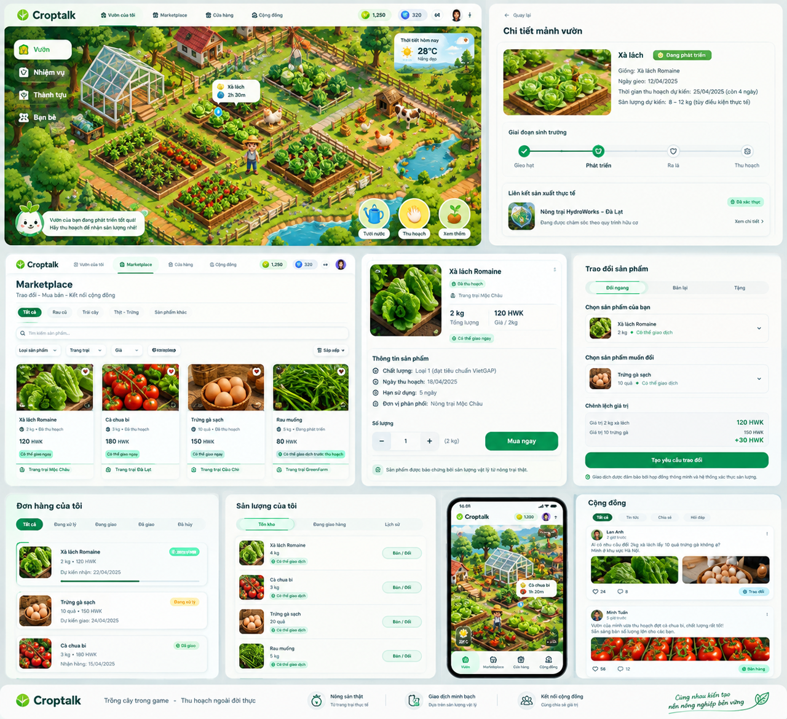
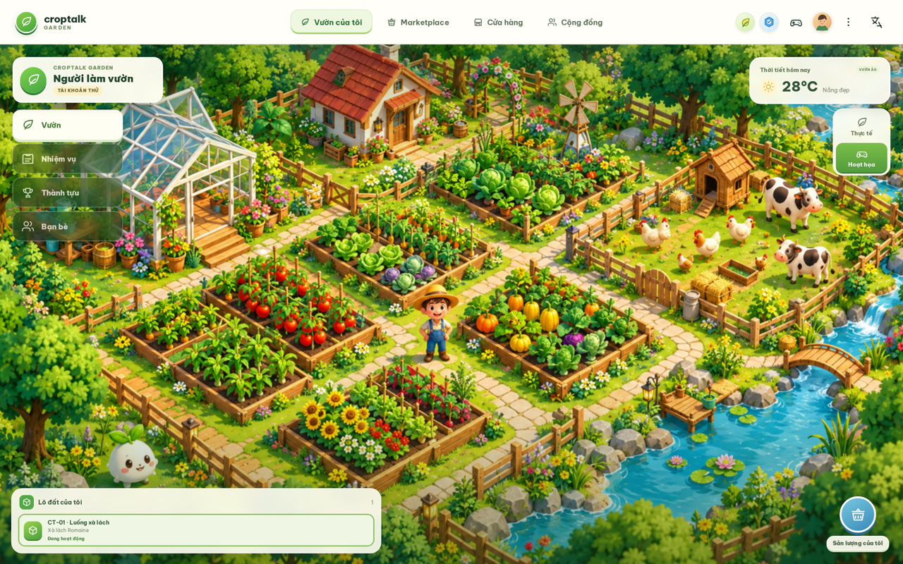
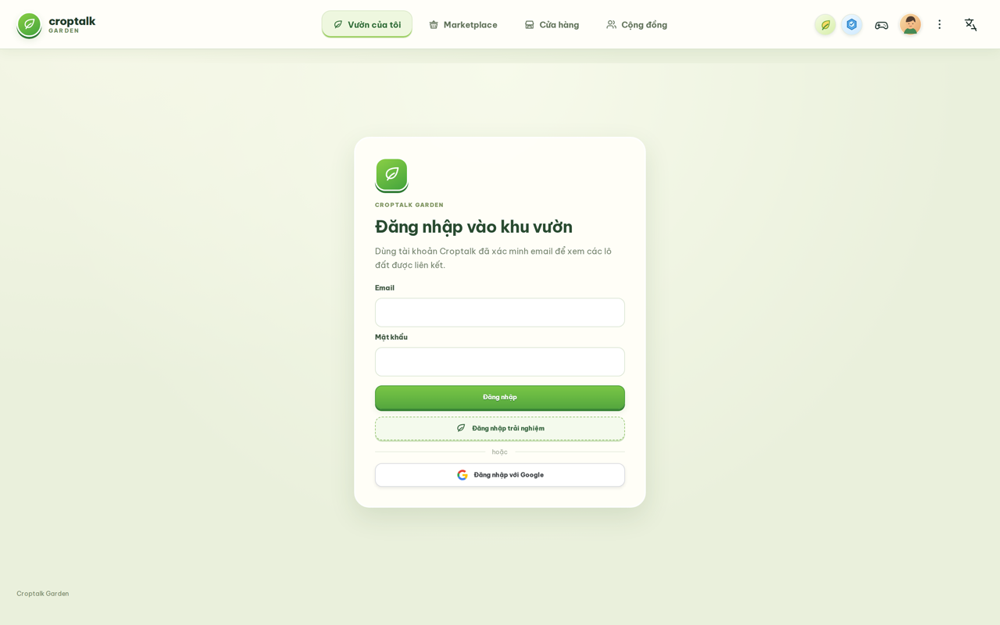
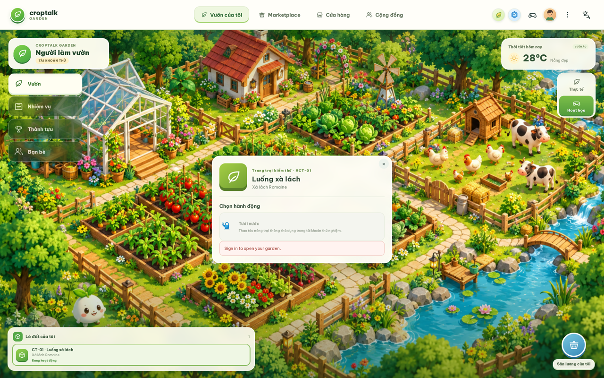
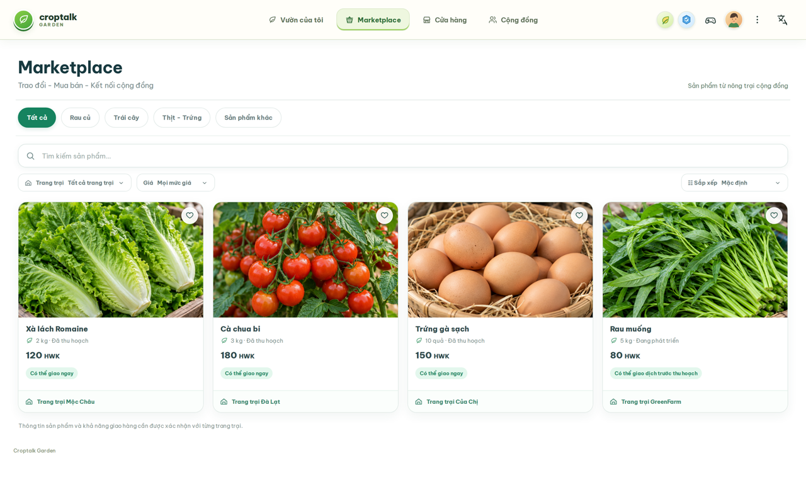
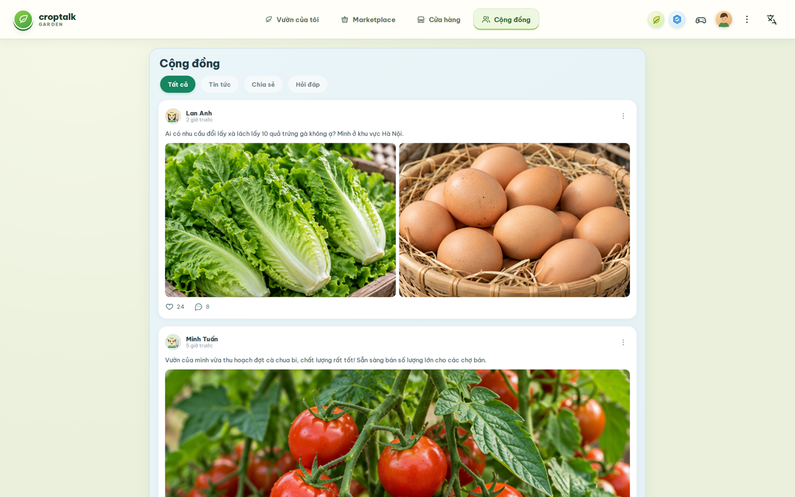
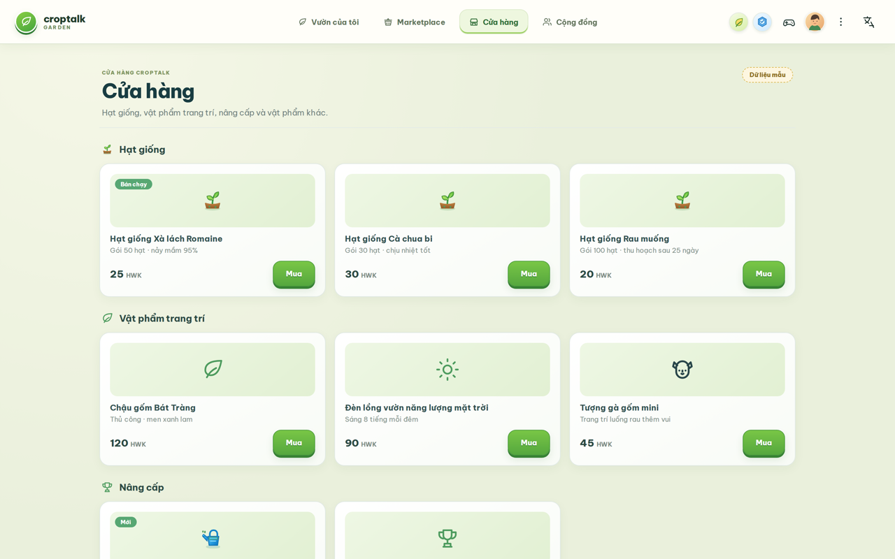
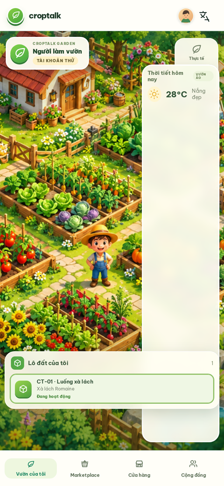

# Croptalk Garden — The Talking Garden

**English** | [Tiếng Việt](README.md)

## Showcase


*UI design board — the visual direction for the main screens.*


*Screenshots taken from a running dev build.*

| Sign in | Plot & actions |
|---|---|
|  |  |

| Marketplace | Community |
|---|---|
|  |  |

| Store |
|---|
|  |

<p align="center">
  
</p>
<p align="center"><em>Mobile view — my garden</em></p>

## Current scope

The first planned slice is Garden and production tracking only. Customers can follow a virtual garden linked to real production, but the initial pilot does not sell services or promise harvest, delivery, or tradeable inventory.

The game is an interaction layer. Any production status shown to customers must come from an authorized, verifiable operational source. Virtual growth must never be treated as physical output.

## Product documents

- [Product vision](docs/croptalk-garden-product-vision.md)
- [Foundation implementation plan](docs/plans/croptalk-garden-foundation-plan.md)

## Local development

```bash
pnpm install
pnpm dev
```
