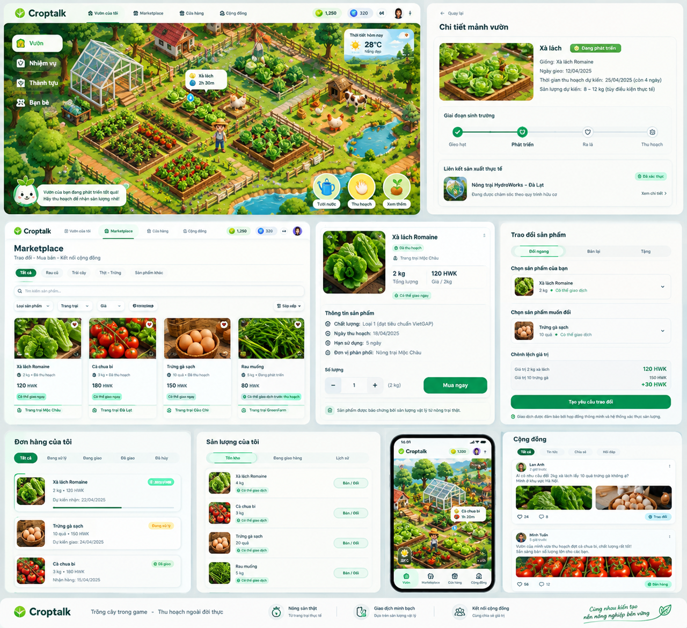
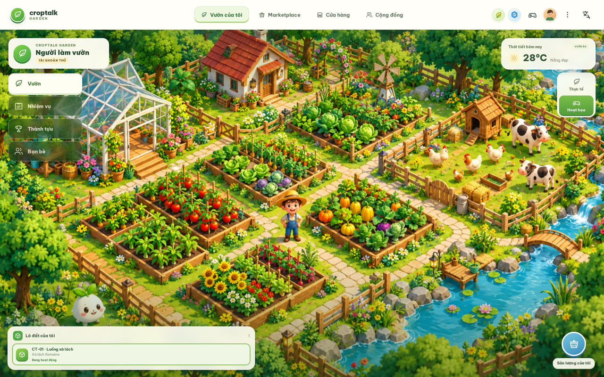
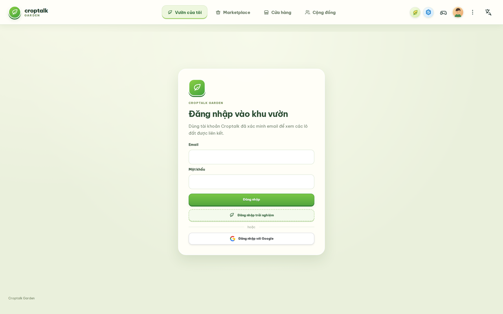
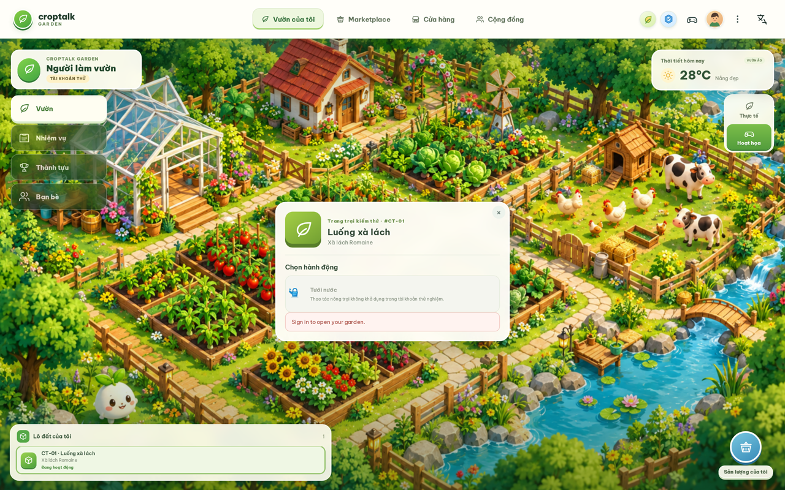
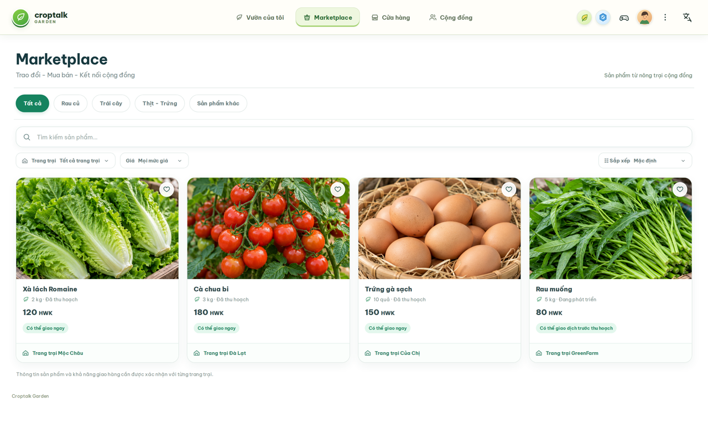
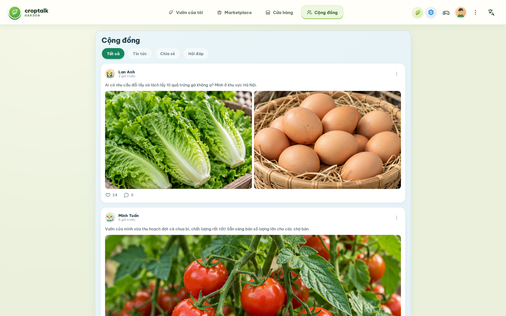
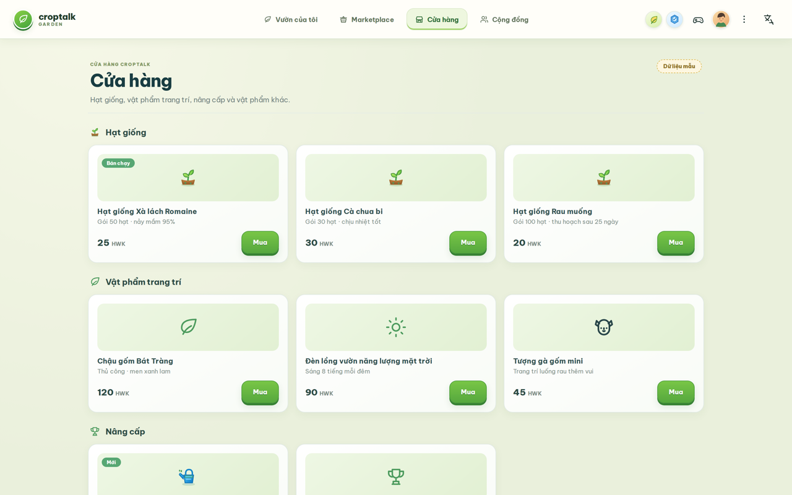
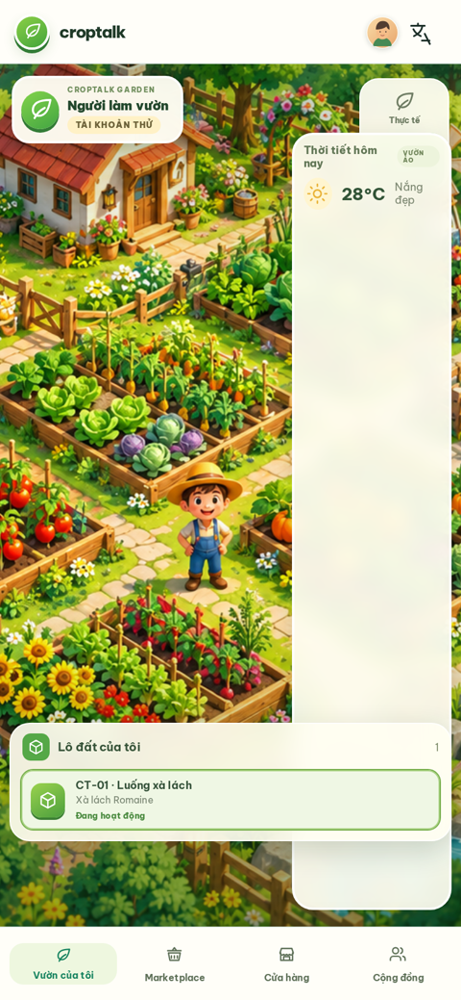

# Croptalk Garden — Khu vườn biết nói

[English](README.en.md) | **Tiếng Việt**

## Showcase


*Bảng thiết kế UI — định hướng giao diện các màn hình chính.*


*Ảnh chụp từ bản dev đang chạy.*

| Đăng nhập | Lô đất & thao tác |
|---|---|
|  |  |

| Marketplace | Cộng đồng |
|---|---|
|  |  |

| Cửa hàng |
|---|
|  |

<p align="center">
  
</p>
<p align="center"><em>Giao diện mobile — vườn của tôi</em></p>

## Phạm vi hiện tại

Lát cắt đầu tiên chỉ gồm Khu vườn và theo dõi sản xuất. Khách hàng có thể theo dõi khu vườn ảo gắn với sản xuất thực, nhưng bản pilot ban đầu không bán dịch vụ, không cam kết thu hoạch, giao hàng hay tồn kho có thể giao dịch.

Game là một lớp tương tác. Mọi trạng thái sản xuất hiển thị cho khách hàng phải đến từ nguồn vận hành được ủy quyền và kiểm chứng được. Tăng trưởng ảo không bao giờ được coi là sản lượng vật lý.

## Tài liệu sản phẩm

- [Tầm nhìn sản phẩm](docs/croptalk-garden-product-vision.md)
- [Kế hoạch triển khai nền tảng](docs/plans/croptalk-garden-foundation-plan.md)

## Phát triển local

```bash
pnpm install
pnpm dev
```
