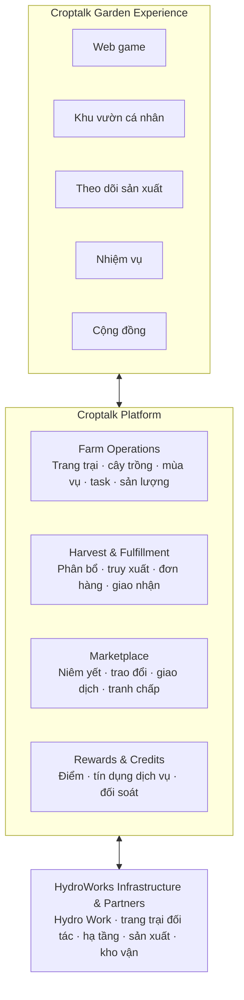

# Croptalk Garden — Khu vườn biết nói

## Tầm nhìn

Croptalk Garden là một phần của nền tảng Croptalk, kết nối con người với hoạt động nông nghiệp thực tế. Người dùng có thể khám phá cây trồng, thiết kế khu vườn, thuê dịch vụ canh tác, theo dõi sản xuất, nhận nông sản và trao đổi thành quả trong một hệ sinh thái số.

Sản phẩm kết hợp bốn mô hình: game hóa canh tác, Farming as a Service, marketplace nông sản và các dịch vụ trong hệ sinh thái HydroWorks. Hoạt động ngoài đời là căn cứ cho cam kết dịch vụ, nguồn gốc, sản lượng và quyền giao dịch. Game tăng trải nghiệm nhưng không phải điều kiện để sử dụng dịch vụ nông nghiệp.

## Các cấp độ tham gia

Các cấp độ là những cách tham gia độc lập, không phải các bước nâng cấp bắt buộc:

1. **Explore — Miễn phí:** khám phá cây trồng, tạo vườn ảo, học canh tác và xem trang trại thực tế.
2. **Grow — Dịch vụ trả phí:** chọn hình thức sản xuất phù hợp với ngân sách; Croptalk và trang trại thực hiện chuyên môn, người dùng theo dõi và đưa ra các lựa chọn thuộc quyền của mình.
3. **Harvest & Trade:** yêu cầu giao sản phẩm, tặng hoặc trao đổi thành quả, hay niêm yết sản lượng đủ điều kiện.
4. **Participate:** tham gia nhiệm vụ cộng đồng, chương trình ưu đãi và hoạt động kinh tế được hỗ trợ trong hệ sinh thái HydroWorks.

Người dùng có thể chỉ chơi miễn phí, chỉ thuê dịch vụ và nhận rau, hoặc chủ yếu tham gia trao đổi sản phẩm.

## Ba hình thức gắn kết với sản xuất

- **Dedicated Plot — Ô trồng riêng:** ô được định danh cho khách hàng; cây trồng, nhật ký và sản lượng gắn với ô đó.
- **Shared Production — Sản xuất dùng chung:** người dùng chọn cây, ngân sách hoặc phần sản lượng được phân bổ từ khu sản xuất chung. Có tiến trình riêng nhưng không mặc nhiên sở hữu ô vật lý.
- **Harvest Allocation — Phân bổ thành quả:** đăng ký quyền nhận một lượng hoặc phần sản lượng theo gói dịch vụ, vụ mùa và tình hình thu hoạch.

Cả ba hình thức dùng chung nền tảng vận hành, nhưng giao diện phải làm rõ quyền lợi và mối liên hệ với sản xuất thực tế.

## Marketplace

Marketplace có ba khu vực:

- **Harvest Market:** niêm yết rau, trái cây, trứng hoặc sản phẩm khác khi người niêm yết có quyền chuyển nhượng hợp lệ; hỗ trợ giao hàng hoặc trao đổi theo chức năng được cung cấp.
- **Swap & Gift:** tặng hoặc trao đổi sản lượng; hỗ trợ xác nhận hai bên, tình trạng sản phẩm và phương thức giao nhận.
- **Community Market:** khám phá sản phẩm, trang trại tham gia, lịch thu hoạch và lựa chọn trao đổi; có thể mở rộng tới nhiều trang trại và nhà sản xuất.

### Quy trình trao đổi

1. Người bán niêm yết sản lượng đã được xác nhận.
2. Croptalk xác minh quyền định đoạt và lượng còn khả dụng.
3. Bên kia đề nghị sản phẩm hoặc điều kiện trao đổi.
4. Hai bên chấp thuận điều kiện.
5. Hệ thống tạo giao dịch và phương án giao nhận.
6. Khi hoàn tất, lượng khả dụng của mỗi bên được cập nhật.

Sản lượng đã bán hoặc đã phân bổ cho đơn hàng không thể tiếp tục được niêm yết là hàng còn sẵn. Nếu chia sản phẩm thành nhiều phần, cần quản lý từng phần để tránh bán trùng.

Sản lượng hiển thị trong game phải tương ứng với sản lượng vật lý có thể giao dịch. Chỉ lượng đã xác nhận, còn khả dụng và đáp ứng điều kiện mới được niêm yết hoặc trao đổi.

## Cây trong game và trạng thái sản lượng

Một cây trong game không mặc nhiên là hàng hóa. Ví dụ, khi người chơi trồng 10 cây xà lách trong vườn ảo, hệ thống cần phân biệt ba trạng thái:

1. **Đang sinh trưởng — chưa phải hàng hóa:** cây ảo đại diện cho kế hoạch hoặc phần sản xuất đã liên kết với nông trại. Chưa thể khẳng định sản lượng thu hoạch cuối cùng.
2. **Đã thu hoạch và xác minh — có hàng thực tế:** sản lượng đạt tiêu chuẩn được ghi nhận thành lô sản phẩm thực tế. Ví dụ, 10 cây cho 2 kg xà lách đạt chuẩn; hệ thống ghi nhận lô 2 kg.
3. **Được phân bổ và giao dịch — có thể giao dịch:** sau khi quyền phân bổ được xác nhận, hệ thống tạo số dư sản lượng có thể giao dịch. Khi bán hoặc đặt giao hàng, lượng tương ứng phải được giữ chỗ hoặc trừ khỏi số dư khả dụng.

Chỉ trạng thái thứ ba được tính là số dư khả dụng để niêm yết hoặc giao dịch; số lượng bị giữ chỗ, đã bán hoặc đã phân bổ cho đơn hàng không còn khả dụng.

Marketplace cần quản lý nguồn gốc trang trại, mã lô, ngày thu hoạch, số lượng khả dụng, tình trạng chất lượng, quyền sở hữu hoặc định đoạt, giá hoặc tỷ lệ trao đổi, phí (nếu có), giao nhận, hủy đơn, khiếu nại, hoàn tiền, cùng điều kiện an toàn thực phẩm và quy định áp dụng theo nhóm hàng.

## Tiến trình, tín dụng và token

- **Garden XP:** điểm tiến trình nhận từ nhiệm vụ, học về cây trồng hoặc hoạt động hợp lệ; mở khóa giống cây, vật phẩm trang trí và nội dung giáo dục. Không mua bán, chuyển nhượng, quy đổi thành tiền hoặc quảng bá như tài sản đầu tư.
- **HydroWorks Credits:** tín dụng dịch vụ nội bộ có thể được đánh giá ở giai đoạn sau, với điều khoản, sổ cái giao dịch, giới hạn sử dụng và quy trình hoàn tiền rõ ràng. Không mặc nhiên chuyển nhượng hoặc quy đổi thành tiền.
- **HydroWorks Token:** chỉ là hướng phát triển sản phẩm trong tương lai, chưa thuộc MVP. Không phát hành token chỉ để tạo nền kinh tế trong game. Token chuyển nhượng chỉ được xem xét khi có nhu cầu giao dịch thực tế và tư vấn pháp lý chuyên biệt.

MVP dùng điểm game không chuyển nhượng và thanh toán thông thường. Các giá trị có thể kiểm chứng gồm thưởng cho hoạt động cộng đồng có ích, ưu đãi khi dùng dịch vụ nông nghiệp, và khả năng dùng tín dụng đủ điều kiện để thanh toán một phần phí. Marketplace chỉ hỗ trợ phương thức thanh toán hợp pháp đã được phê duyệt.

## Kiến trúc hệ sinh thái

Sơ đồ dưới đây thể hiện ba lớp và các kết nối hai chiều giữa trải nghiệm, nền tảng nghiệp vụ và năng lực sản xuất/giao nhận:

Experience cung cấp giao diện người dùng; Croptalk Platform quản lý vận hành trang trại, phân bổ/hoàn tất thu hoạch, marketplace và điểm/tín dụng; HydroWorks cùng đối tác cung cấp năng lực hạ tầng, sản xuất và kho vận. Dữ liệu sản lượng và quyền giao dịch phải được đồng bộ với nguồn vận hành có thẩm quyền.

## Lộ trình phát triển

### Phase 1 — Foundation: Khu vườn thật + mini game

- Vườn ảo và tài khoản khách hàng.
- Liên kết ô trồng, luống hoặc sản lượng thực tế.
- Nhật ký, bằng chứng, thu hoạch và giao hàng.
- Thử nghiệm dịch vụ trả phí với nhóm khách hàng nhỏ.

### Phase 2 — Marketplace: Trao đổi và giao dịch sản lượng

- Tặng, đổi và niêm yết sản phẩm.
- Quản lý quyền định đoạt, tồn lượng và truy xuất.
- Xây dựng giao nhận, khiếu nại và đối soát.
- Chỉ mở rộng sau khi chứng minh được nhu cầu thực.

### Phase 3 — Network: Mạng lưới nhiều trang trại

- Mở rộng nhà sản xuất và địa điểm.
- Chuẩn hóa danh mục sản phẩm và chất lượng.
- Phát triển dịch vụ cho đối tác.
- Xây dựng chương trình thành viên và tín dụng dịch vụ.

### Phase 4 — Economy: Nền kinh tế HydroWorks

Đánh giá token chuyển nhượng, các hình thức thanh toán và mô hình khuyến khích khi đã có giao dịch thực, dữ liệu vận hành và cơ sở pháp lý phù hợp.
